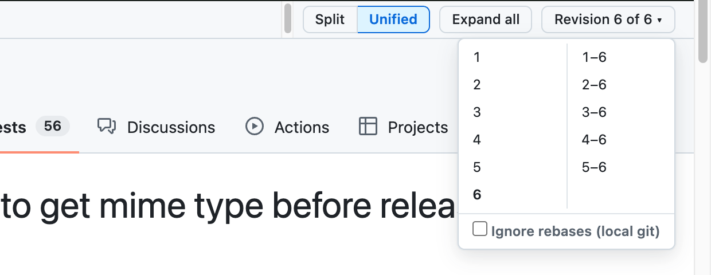
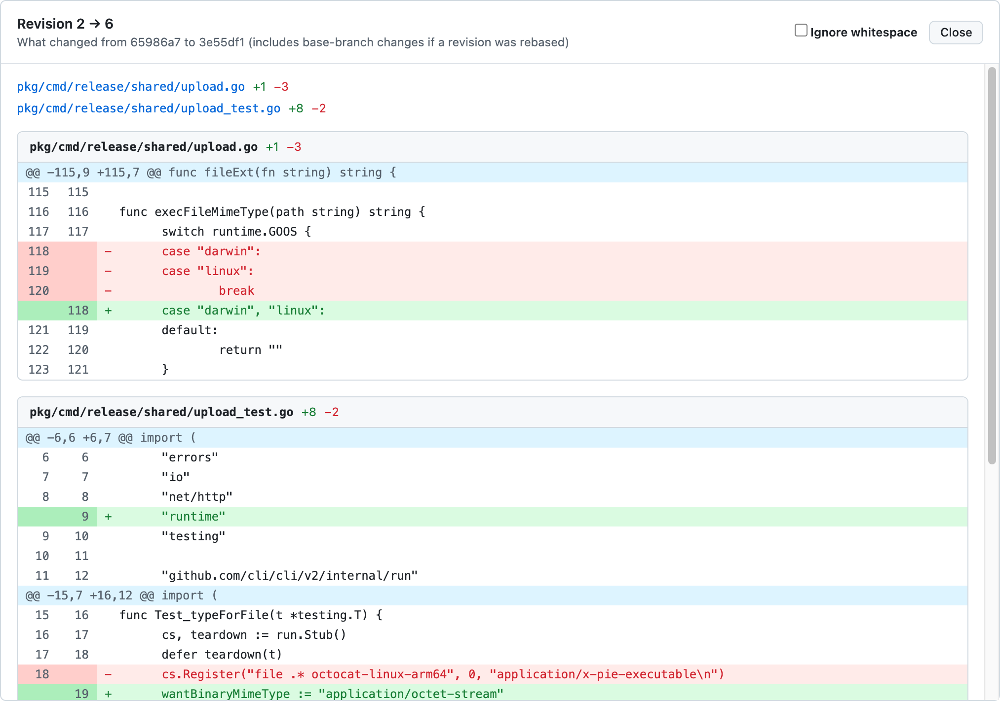
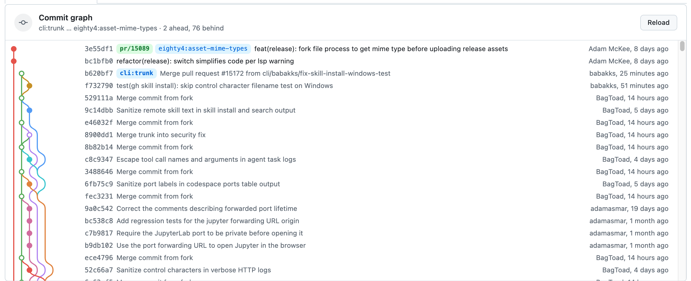
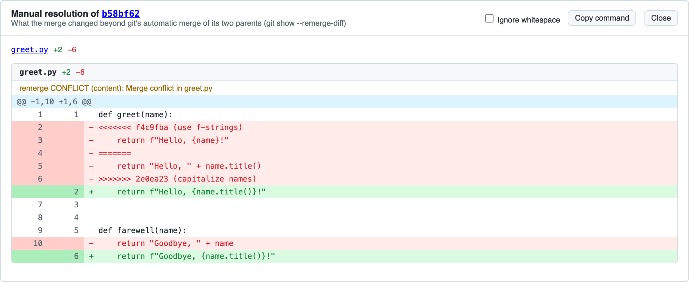
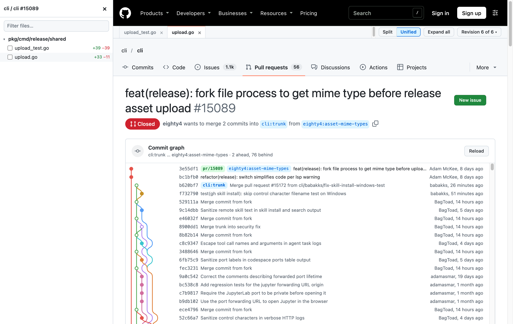
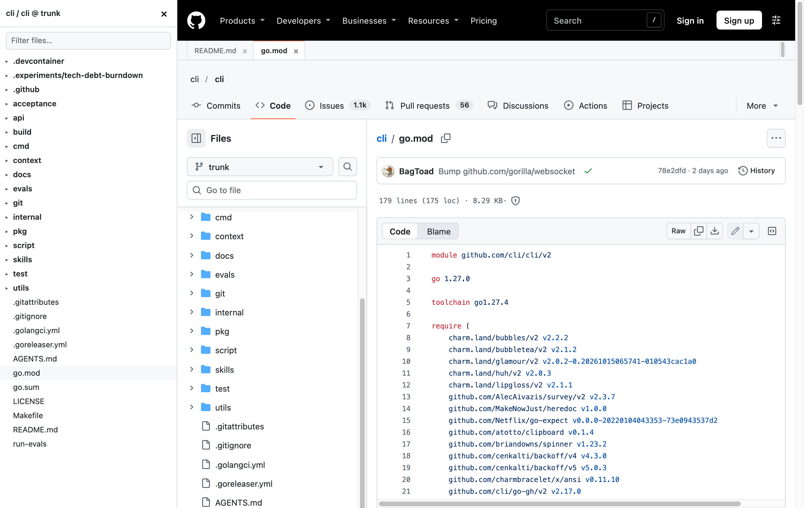

<p align="center">
  
</p>

<h1 align="center">Le Git Graph Plus</h1>

<p align="center">
  <b>Gerrit-style review tools for GitHub</b>, for people who spend their day reviewing pull requests.<br>
  Revisions you can compare, the real commit graph, the hand-made part of a merge, and an IDE-like file tree, all on the PR page.
</p>

<p align="center">
  
  
  
  
</p>

---

## Why

GitHub is great for small PRs and hard for long reviews. Once a PR has been force-pushed a few times, rebased and merged with its base, it's hard to see
**what changed since you last looked**, **how the branch relates to the base** and **what the author fixed by hand** during a merge.
Gerrit users get all of that out of the box. This extension brings it to GitHub.

## Features

### Revisions, like patch sets
Every push of a PR is a revision. Pick one to see the PR as it was, or pick `i–N` to see only what changed from revision *i* to the latest, right on the page.
Tick **Ignore rebases** to match commits across revisions with `git range-diff`, so a rebase alone counts as no change.

<p align="center"></p>
<p align="center"></p>

### The commit graph of the PR
A `git log --graph` view of the PR next to its base branch: the PR's commits, what landed on the base since they diverged, the merge base, and branch labels.

<p align="center"></p>

### Manual resolution of merge commits
GitHub shows a merge commit's whole diff. **Manual resolution** shows only the edits the author made by hand on top of git's automatic merge (`git show --remerge-diff`).

<p align="center"></p>

### A file tree, file tabs and review helpers
- **File tree** (☰, bottom left): the repo at the branch you're viewing, or a PR's changed files with `+/−` counts. Click a file to jump to its diff.
- **Viewed checkboxes** in the tree, kept in sync with GitHub's own *Viewed* button.
- **File tabs**: every file you open stays one click away.
- **Split | Unified** and **Expand all** (every file in full, in one click) in the same bar.

<p align="center"></p>
<p align="center"></p>

### The whole-repo graph
The **Commits** tab from [le-git-graph](https://github.com/NirmalScaria/le-git-graph) is still there, for the graph of the whole repository.

## Install

1. Clone this repo.
2. Open `chrome://extensions` (Edge: `edge://extensions`, Brave: `brave://extensions`), turn on **Developer mode** and click **Load unpacked**. Pick the cloned folder.
3. Open any pull request on GitHub.

After pulling updates, press ↻ on the extension's card and reload the GitHub tab.

### GitHub token (optional)
Without a token GitHub allows 60 API calls per hour, which is enough for light use on public repos. For more, or for private repos:

1. Create a token at <https://github.com/settings/tokens/new>. A classic token with **no scopes** is enough for public repos; tick `repo` for private ones.
2. If the repo belongs to an org with SAML single sign-on, click **Configure SSO → Authorize** next to the token.
3. On any repo, open the **Commits** tab, paste the token and click **Save token**.

The token stays in your browser and is sent only to `api.github.com`. If an org rejects it, requests for that org fall back to anonymous ones.

### Local git helper (optional)
**Manual resolution**, the in-page revision diffs and **Ignore rebases** run `git` in a local clone through a small native-messaging helper.

```sh
native/install.sh                      # registers the helper with Chrome / Brave / Edge, for this extension only
$EDITOR ~/.remerge/repos.json          # {"owner/repo": "/path/to/clone"}
```

Then restart the browser. The helper serves only the repos listed in `repos.json`. It validates every input and runs git without a shell.
When the clone lacks a commit, the helper fetches it as git objects only, without creating a branch or ref.
`native/install.sh --uninstall` removes it. It needs git 2.36 or newer.

## Privacy
The extension talks only to GitHub. Upstream le-git-graph's sign-in through its author's server, its usage call and its first-run tour are removed.
You add a token yourself if you want one.

## Development
- Plain JavaScript and CSS with no build step. New code lives in `js/common`, `js/pr`, `js/tree`, `css/` and `native/`.
- `node test/vs-git.js <owner> <repo> <pr> <clone> <base>` checks the commit graph against `git log` in a local clone.
- `test/e2e.js` loads the extension in Chromium and checks the panels render. It needs `playwright-core`; see the file's header.
- `python3 test/remerge_call.py native/remerge_host.py '<json>'` calls the git helper directly.
- To get upstream updates: `git fetch upstream && git merge upstream/main`.

## Credits and license
Built on [le-git-graph](https://github.com/NirmalScaria/le-git-graph) by Nirmal Scaria, released under the MIT license ([LICENSE.md](LICENSE.md)). The additions are under the same license.
